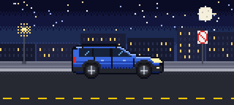
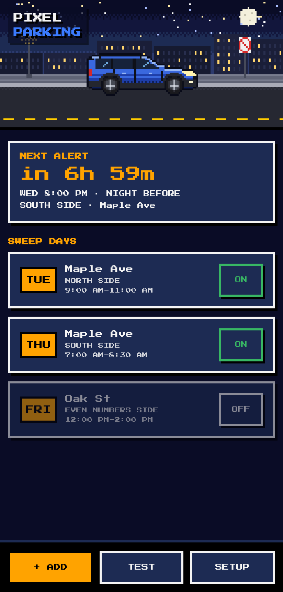
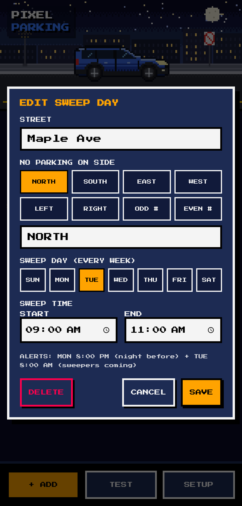
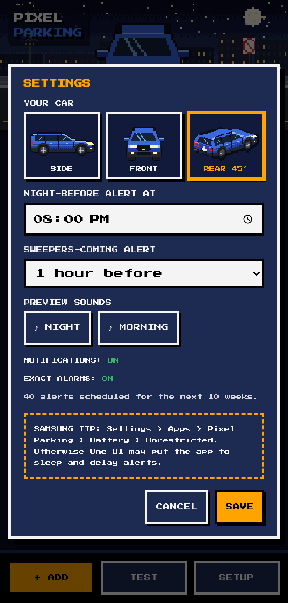
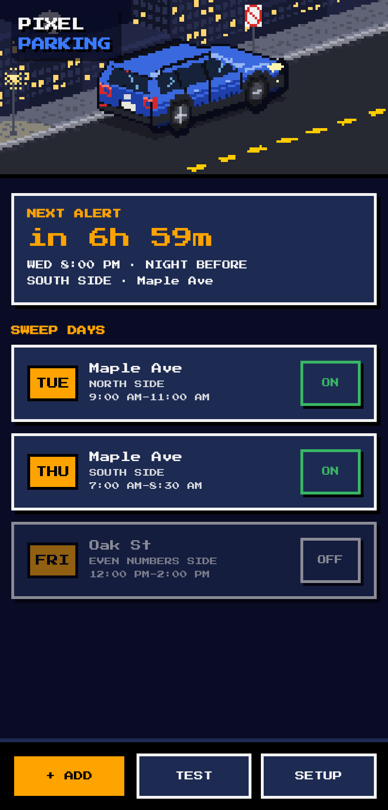
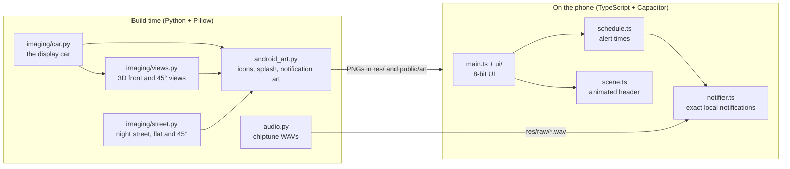
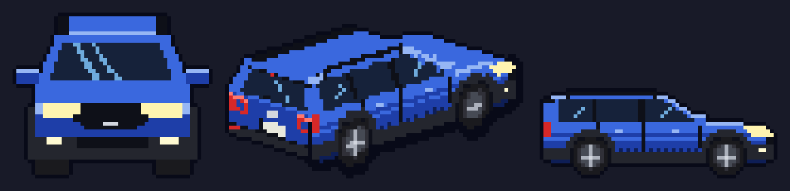
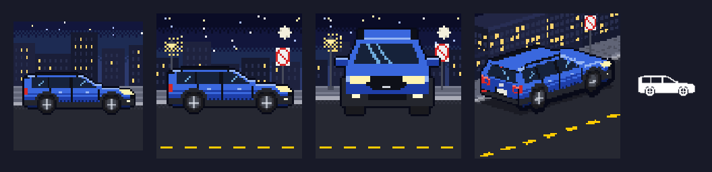
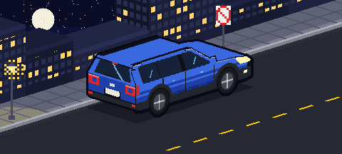

# Pixel Parking

**An 8-bit street-sweeping reminder for Android. Move your car before the sweepers and the ticket arrive.**

Tell it which side of which street gets swept on which day, and it taps you on the shoulder twice: **at 8 PM the night before**, and **an hour before the sweepers come**. Each alert comes with a chiptune jingle and a hand-coded pixel-art car.

[](https://github.com/Jcardenas34/parking_sweeper_reminder_pixel/actions/workflows/ci.yml)


<p align="center">
  
</p>

<p align="center">
  
  
  
  
</p>

## Features

- **Two alerts per sweep.** "MOVE YOUR CAR TONIGHT" the evening before, at 8 PM by default, and "SWEEPERS IN 1 HR!" before the sweep starts. You can change both times.
- **Weekly rules.** Street, side (North / South / East / West / Left / Right / odd or even numbers, or anything you type), weekday and time window. Pause a rule with one tap.
- **Fires on time.** Alarms are exact and allowed in Doze, so they ring with the phone locked and come back after a reboot. A rolling 10-week schedule refreshes every time you open the app.
- **Runs on the phone.** No server, no account, no network. Your rules stay on the device.
- **Three views of the car.** Side, head-on, or 45° from behind on a street drawn from the same angle. Your pick shows in the header and inside every notification.
- **Chiptune alerts.** Square-wave jingles: a soft one for the night before, a reveille for the morning. They're generated in code, and the same notes play in the app and as the Android notification sound.

## Quick start

| Want to | Do this |
|---|---|
| **Try it in a browser** | `cd frontend && npm install && npm run assets:web && npm run dev`, then open http://localhost:5173. Browsers can't post Android notifications, so **TEST** plays the jingle and the animation instead. |
| **Install on Android** | Download `pixel-parking-debug-apk` from the [latest CI run](https://github.com/Jcardenas34/parking_sweeper_reminder_pixel/actions/workflows/ci.yml?query=branch%3Amain) (you need to be signed in to GitHub), or [build it yourself](#build-the-android-app). The APK is debug-signed, so Android asks you to allow "install unknown apps", and Play Protect may warn you once. |

After installing:
1. Open the app and tap **ENABLE ALERTS**.
2. Add your sweep days with **+ ADD**.
3. Tap **TEST** and lock the phone. A sample alert arrives five seconds later.

On Samsung phones, also set **Settings → Apps → Pixel Parking → Battery → Unrestricted**, or One UI may delay alarms. Other brands have a similar battery-optimisation switch.

## How it works



- **The phone does all the work.** `schedule.ts` turns weekly rules into concrete alert times from local wall-clock fields, so 8 PM stays 8 PM across daylight-saving changes. `notifier.ts` schedules them as one-shot exact alarms for the next 10 weeks, and replaces the whole set on launch, on resume and after every edit. Repeating alarms are less reliable on some Android skins, which is why it uses one-shots.
- **Python only runs at build time.** Every pixel is drawn in code, with no image editor involved:
  - **Side view:** `car.py` describes the car as continuous shapes (body, glass, cladding, lights, wheels). The 64×24 sprite samples them at pixel centres, and high-resolution renders sample them finely, so the two always match.
  - **Front and 45° views:** `views.py` extrudes the side profile into a simple 3D body, narrows the cabin toward the roof, and draws it through an orthographic camera.
  - **45° street:** ray-cast through the same camera, so the kerb and buildings run parallel to the car.
- **Sounds stay in sync.** The jingle note tables live in both `audio.py` and `sound.ts`, and a test fails if they differ.

<p align="center">
  
</p>
<p align="center">
  
</p>

The 45° scene renders at any resolution. Here it is at 3× the app header (`python -m parking --hd-sample out.png --hd-scale 3`):

<p align="center">
  
</p>

## Project layout

| Path | What's there |
|---|---|
| `backend/parking/imaging/car.py` | The display car: side-view shapes, 3D profile, front and rear face details |
| `backend/parking/imaging/views.py` | 3D engine for the front and 45° rear views |
| `backend/parking/imaging/street.py` | The night street, flat and ray-cast at 45° |
| `backend/parking/imaging/hires.py` | High-resolution render of the 45° scene |
| `backend/parking/android_art.py` | Launcher icons, splash screens, notification art, web art |
| `backend/parking/audio.py` | Renders the chiptune jingles to WAV |
| `frontend/src/schedule.ts` | Rules → alert times, notification text (pure, unit tested) |
| `frontend/src/notifier.ts` | Android channels, permissions, rolling exact-alarm schedule |
| `frontend/src/main.ts`, `ui/panels.ts`, `scene.ts`, `styles.css` | The 8-bit UI and animated header |
| `frontend/android/` | Capacitor Android project (exact-alarm permission, portrait) |
| `tests/` | Python tests: art, views, audio, hi-res parity |

## Development

You need Python 3.10+ with Pillow, and Node 22. A conda environment provides everything, including the JDK for Android builds:

```bash
git clone https://github.com/Jcardenas34/parking_sweeper_reminder_pixel.git
cd parking_sweeper_reminder_pixel
conda env create -f environment.yml && conda activate pixel-parking
cd frontend && npm install
```

### Run in the browser

```bash
cd frontend
npm run assets:web   # draw the car and street art into public/art
npm run dev          # http://localhost:5173
```

### Build the Android app

You need the Android SDK (platform 36 and build-tools 35) and JDK 17 or newer. From WSL, `bash scripts/setup-android-sdk.sh` installs both the SDK and the Windows `adb.exe`, then prints the `ANDROID_HOME` and `WIN_ADB` exports to add to `~/.bashrc`. Elsewhere, Android Studio's SDK works too.

```bash
cd frontend
npm run android:build     # art + web build + cap sync + gradle assembleDebug
npm run android:install   # adb install to a USB-connected phone (USB debugging on)
```

### Tests

```bash
python -m pytest tests     # art, 3D views, audio, hi-res vs sprite parity
cd frontend && npm test    # alert maths (DST, week and month edges, ids), storage, icons
```

CI runs both suites, type-checks and builds the debug APK on every push.

### Change the car or the sounds

- **Car:** everything model-specific (side-view shapes, width, 3D profile, front and rear details) is in `backend/parking/imaging/car.py`. Edit it, then run `npm run assets:export`.
- **Jingles:** change the note tables in **both** `backend/parking/audio.py` and `frontend/src/sound.ts`; the tests check they match. Android fixes a channel's sound once the channel exists, so also bump the channel id suffix (`-v1` → `-v2`) in `notifier.ts`.

## Credits

The 8-bit look, the Capacitor notification setup and the pixel-painting approach come from my earlier project, [Pixel Pomodoro](https://github.com/Jcardenas34/pomodoro_timer_pixel). The font is [Press Start 2P](https://fonts.google.com/specimen/Press+Start+2P) by CodeMan38, and the UI colours come from the [PICO-8](https://www.lexaloffle.com/pico-8.php) palette.

The display car is a fan-made pixel drawing in the style of a 2022 Subaru Crosstrek. Subaru and Crosstrek are trademarks of Subaru Corporation; this project isn't affiliated with or endorsed by Subaru.

## License

[MIT](LICENSE) © 2026 Juan Cardenas
